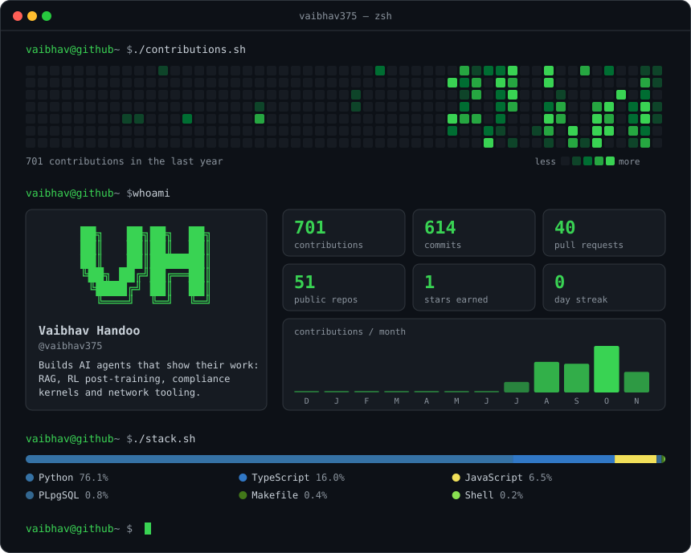

### `vaibhav@github ~ $ ls ./projects`

| | |
|---|---|
| **[recovery-ledger](https://github.com/vaibhav375/recovery-ledger)** Agent that decides whether to contact a customer at all, with a deterministic compliance kernel and a randomised holdout. | **[minimi-search-agent](https://github.com/vaibhav375/minimi-search-agent)** Chat agent with one tool (web search): cited answers and a dated memory it re-checks against the live web. |
| **[rlvr-reasoning-engine](https://github.com/vaibhav375/rlvr-reasoning-engine)** GRPO post-training of a small LLM for Text-to-SQL, rewarded by sandboxed SQLite execution. | **[protocol-toolkit](https://github.com/vaibhav375/protocol-toolkit)** HTTP/1.1, HTTP/2, HTTP/3, DNS and SMTP on raw sockets, with a byte-level inspector and pcapng export. |
| **[saanjh](https://github.com/vaibhav375/saanjh)** Catches the farm fires India's satellites miss and warns people before the smoke arrives. | **[drishti](https://github.com/vaibhav375/drishti)** Offline space domain awareness: behavioural threat analysis from public TLEs. |

The card above is regenerated daily by <a href="./.github/workflows/update.yml">a GitHub Action</a> from the GitHub API.
